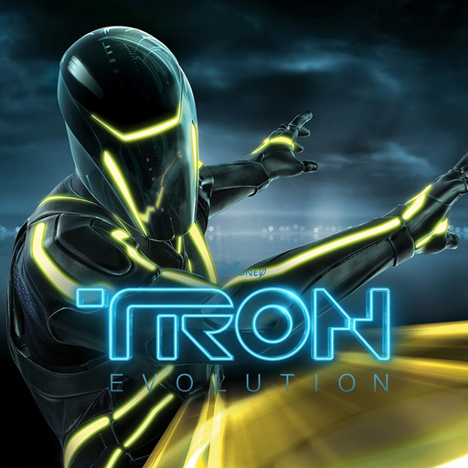
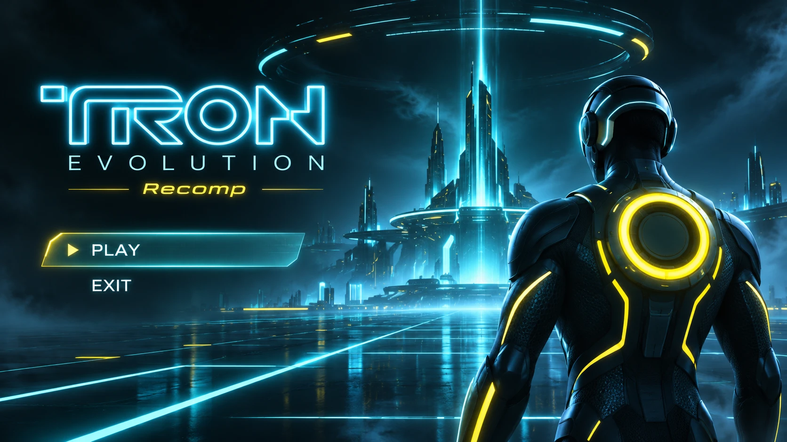

  

# Tron: Evolution PS5 Port

Play Tron: Evolution on a homebrew-enabled PS5. The port runs the Xbox 360 game through a native renderer at 60 fps, with PlayStation button prompts, a launcher that plays straight from your own Xbox 360 disc image, settings, and achievement popups.

  

## Install V1.0.1

1. Download `Tron.Evolution.PS5.Port.V1.0.1.zip` from [GitHub Releases](https://github.com/KongaTime/Tron-Evolution-PS5-Port/releases/tag/v1.0.1).
2. Extract the `PPSA90120` folder to `/data/homebrew/` on a PS5 set up to run homebrew. Register the title with ShadowMount+.
3. Create a `dump` folder inside `PPSA90120` and place your Xbox 360 disc ISO in it.
4. Open **Tron Evolution** on the PS5 and choose **PLAY**. The launcher checks the disc and starts the game. The disc isn't copied: the game reads it directly from `dump/`, so leave the ISO there.

The port supports the **Disney Tron: Evolution (USA, Europe)** Xbox 360 disc (title ID `425607ED`). No title update is needed. If the launcher says the disc isn't the supported release, check that the ISO is a full, unmodified image of that disc.

If your game files are already extracted, you can put them in `PPSA90120/gamedata/` instead, with `default.xex` at that folder's root. The launcher plays an extracted `gamedata/` folder whenever one is there.

To update from an earlier version, close the app and copy the new `PPSA90120` folder over the existing one. Your ISO, saves, settings and achievements stay in place.

## Settings

Choose **SETTINGS** in the launcher. Up/Down moves, Left/Right or Cross changes a value, and Circle goes back. Your choices are saved and apply when you press **PLAY**.

| Setting | Options |
|---|---|
| Resolution | 1440p (default) or 4K. Applies after reopening the app. |
| Frame rate | 60 fps (default) or 30 fps. |
| Brightness | 60% to 150% in 5% steps. 100% is tuned to match the Xbox 360. |
| Anti-aliasing | SMAA on or off. |
| Shadows | High (twice the Xbox 360's shadow resolution) or Normal. |
| Button icons | PlayStation (default) or the original Xbox icons. |

## Features

- **Native renderer.** The Xbox 360's graphics calls are drawn directly with Vulkan on the PS5 instead of emulating its GPU, which removes the white flashes of GPU emulation and runs the game at 60 fps at 1440p. The busiest scenes run in the 50s.
- **Plays from your ISO.** Nothing is extracted or copied to the console.
- **PlayStation button prompts** in the game's own menu and in-game styles, including the combo list.
- **Achievements** unlock as on the Xbox 360, are saved between sessions, and pop up with a Tron-styled notification and sound.
- **Smooth frame pacing**, with work sent to the GPU as each frame is recorded and four screen buffers.
- **Colour matched to the Xbox 360**, with the game's own gamma ramp, the 360's HDR render target ranges, and a tuned presentation curve.

The game's lens flares and light glare are hidden. On the Xbox 360 they are hidden when a wall blocks their light, which the port can't measure yet, and showing them always drew them through walls as a blue haze.

## Build and source

See the [native renderer and build notes](native/README.md). The runtime changes are in [patches/rexglue-tron-native.patch](patches/rexglue-tron-native.patch). Building needs your own `default.xex` from the disc to generate the game code; neither game files nor generated code are part of this repository.

## Credits

- **KongaTime** for the PS5 port and console testing.
- **florinp93 and the Hell's Gate contributors** for the native renderer this port adapts, through the Dante's Inferno PS5 port. [Hell's Gate](https://github.com/florinp93/hells-gate-recomp) · [Dante's Inferno PS5 Port](https://github.com/KongaTime/Dantes-Inferno-PS5-Port)
- **The ReXGlue contributors** for the Xbox 360 recompilation tools and runtime. [ReXGlue SDK](https://github.com/rexglue/rexglue-sdk)
- **mihawk-99 and the Mesa/RADV contributors** for the Vulkan stack that runs the renderer on PS5. [PS5 Vulkan](https://github.com/mihawk-99/PS5_Vulkan)
- **The DiligentCore contributors** for the graphics framework used by the native renderer. [DiligentCore](https://github.com/DiligentGraphics/DiligentCore)
- **Kenney** for the controller icon assets used in the PlayStation prompts. [Icon license](native/assets/glyphs/kenney/LICENSE.txt)

Tron: Evolution is © Disney. This is an unofficial fan project, not affiliated with or endorsed by Disney or Microsoft. You need your own copy of the game.
